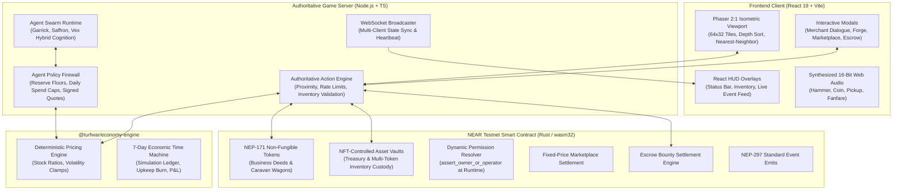

# TURFWAR — System Architecture & Data Flow Overview (docs/architecture/SYSTEM_OVERVIEW.md)

**Project:** TURFWAR — Isometric Pixel-Art Economic RPG on NEAR  
**Revision:** 1.0.0  

---

## 1. High-Level System Architecture

TURFWAR bridges a rich 16-bit browser gaming experience with deterministic server-side economic orchestration and on-chain ownership settlement on NEAR Testnet.



---

## 2. Core Subsystems

### 2.1 2:1 Isometric Rendering Engine (Phaser Scene)
- **Coordinate Conversion:** Mathematical transformation from 2D isometric grid coordinates $(G_x, G_y)$ to screen pixel coordinates $(S_x, S_y)$:
  $$S_x = \text{Origin}_x + (G_x - G_y) \times \frac{\text{TileWidth}}{2}$$
  $$S_y = \text{Origin}_y + (G_x + G_y) \times \frac{\text{TileHeight}}{2}$$
- **Depth Sorting:** All entities and props have ground contact anchors set at $(0.5, 0.85)$ and depth values computed dynamically from $Y$ foot coordinates.
- **Pixel Perfection:** Integer scaling with nearest-neighbor texture filtering prevents anti-aliased blurring.

### 2.2 Dynamic Asset Vault Ownership Hand-off
Conventional web3 games assign vaults to NEAR account IDs. TURFWAR binds asset vaults directly to **NEP-171 Token IDs**:
```rust
pub fn vault_withdraw(&mut self, token_id: TokenId, amount: U128) -> Promise {
    let caller = env::predecessor_account_id();
    let token = self.tokens.get(&token_id).expect("Token not found");
    assert_eq!(
        token.owner_id, caller,
        "Security violation: Caller is not the current owner of this Business Deed NFT"
    );
    // ...
}
```
When an NFT transfers to a new buyer on the marketplace, `token.owner_id` updates immediately. The previous owner loses all managerial access and withdrawal rights at the contract level.

### 2.3 Hybrid Cognition AI Swarm
- **Perception:** Structured world snapshot containing raw material prices, business stock levels, and open bounties.
- **Memory:** Episodic log tracking recent fulfilled/refused quotes, trade outcomes, and counterpart reputation.
- **Planning:** Deterministic rule-based fallback ensuring 100% testability and reliability during network disruptions.
- **Policy Engine:** Hard spend caps and minimum reserve floors prevent agent insolvency.
