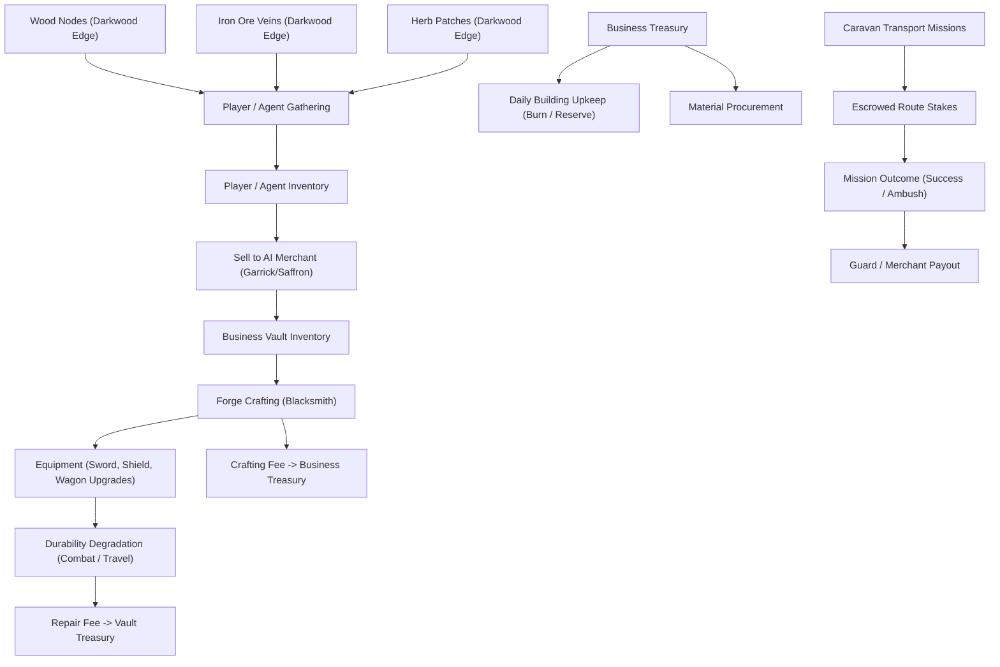

# TURFWAR — Economic Model & Deterministic Formulae (docs/economy/ECONOMY_MODEL.md)

**Project:** TURFWAR  
**Status:** Canonical Reference  

---

## 1. Principles: Closed-Loop Real Economy

The TURFWAR economy is intentionally designed to avoid hyperinflation, arbitrary payouts, or unbacked token printing. Every resource and currency unit originates from verified work or funded escrow, and is balanced by durable sinks.

---

## 2. Resource Hierarchy

| Resource ID | Name | Tier | Primary Source | Primary Sink | Base Ref Price (NEAR) |
|---|---|---|---|---|---|
| `wood` | Timber Wood | Raw (T1) | Forest Gathering | Crafting, Caravan Repair | 0.25 NEAR |
| `iron_ore` | Iron Ore | Raw (T1) | Mine Gathering | Ingot Smelting | 0.50 NEAR |
| `herbs` | Silverleaf Herb | Raw (T1) | Wild Gathering | Potions, Courier Stash | 0.35 NEAR |
| `iron_ingot` | Refined Ingot | Refined (T2) | Blacksmith Smelting | Weapons, Armor, Wagons | 1.40 NEAR |
| `sword_iron` | Frontier Broadsword | Equipment (T3) | Blacksmith Crafting | Guard Missions, Combat | 4.50 NEAR |
| `shield_iron`| Reinforced Buckler | Equipment (T3) | Blacksmith Crafting | Defense in Ambushes | 4.00 NEAR |
| `repair_kit` | Artisan Repair Kit | Consumable | Crafting Workshop | Restores Caravan & Gear | 1.80 NEAR |

---

## 3. Dynamic Pricing Engine

AI merchants do not use LLMs to guess prices. Instead, they calculate mathematically transparent, bounded bids and asks based on real inventory state.

### 3.1 Pricing Formula

For a resource $r$ at merchant $m$:
- $P_{ref}$: Base reference price
- $S$: Current stock in merchant vault
- $S_{target}$: Ideal target stock level (e.g. 50 units)
- $V_{recent}$: 24h trade velocity factor (0.5 to 2.0)
- $L$: Merchant liquidity ratio ($\min(1.0, \text{Treasury} / \text{ReserveFloor})$)

$$\text{Stock Ratio } R_s = \frac{S}{S_{target}}$$

$$\text{Price Multiplier } M = \text{clamp}\left( (1.0 - 0.4 \times (R_s - 1.0)) \times V_{recent}, \ 0.5, \ 2.0 \right)$$

$$\text{Unit Sell Price (Merchant Asks)} = P_{ref} \times M \times (1.0 + \text{MarginRate})$$

$$\text{Unit Buy Price (Merchant Bids)} = P_{ref} \times M \times (1.0 - \text{SpreadRate}) \times L$$

- $\text{MarginRate}$: Standard 15% mark-up ($0.15$)
- $\text{SpreadRate}$: Standard 15% bid-ask spread ($0.15$)
- The multiplier is strictly clamped between $0.5\times$ and $2.0\times$ reference price to prevent unbounded volatility spikes.

---

## 4. Business Upkeep & Reserves

Every business deed NFT incurs daily operational upkeep:
- Blacksmith Forge: 1.5 NEAR / 7 game cycles (fuel, anvil maintenance, tax).
- Merchant Stall: 0.8 NEAR / 7 game cycles (stall license, spoilage).
- If treasury balance falls below upkeep cost, the business enters `DEGRADED` status: crafting output is halved and quotes apply an emergency liquidation discount until recapitalized.
